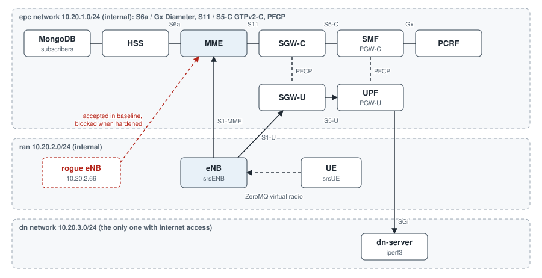
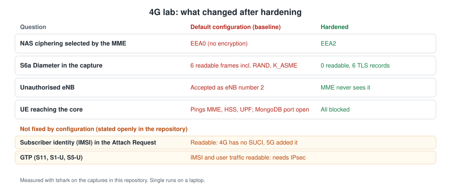

# 4G LTE Core + Radio Lab with Security Analysis

A reproducible 4G network (EPC + simulated eNodeB and phone) running in Docker, used to
**measure real security weaknesses of a default 4G deployment, verify the fixes, and see what
5G changed**. It is the companion of the 5G SA lab ([repository](https://github.com/derrah-mustapha/5g-sa-security-lab)).

- **Core (EPC):** [Open5GS](https://open5gs.org) 2.7.2: MME, HSS, SGW-C, SGW-U, SMF (PGW-C), UPF (PGW-U), PCRF
- **RAN + UE:** [srsRAN 4G](https://github.com/srsran/srsRAN_4G) (srsENB + srsUE, image `gradiant/srsran-4g:23_11`)
  connected by a **ZeroMQ virtual radio**: no radio hardware, nothing is transmitted over the air
- **Analysis:** tshark in a container, scripted experiments, results in `results/`

## Architecture



| Network | Purpose | Internet |
|---|---|---|
| `epc` 10.20.1.0/24 | Diameter, GTPv2-C, PFCP between core nodes | no |
| `ran` 10.20.2.0/24 | S1-MME, S1-U, S5-U (GTP-U), virtual radio | no |
| `dn` 10.20.3.0/24 | SGi, data network, iperf3 server | yes (via host) |

One subscriber (IMSI `999700000000001`, APN `internet`, PLMN 999/70). The radio is 5 MHz (25 PRB), so
throughput is about 8-9 Mbit/s and RTT about 30 ms; those numbers describe the virtual radio, not the core.

## Run it

Requirements: Linux, Docker with Compose v2, about 3 GB free RAM (stop other labs first). The host kernel must be
able to load `sctp` (autoloads on Ubuntu).

```bash
scripts/lab.sh up baseline        # Open5GS defaults (about 1.5 minutes: waits for the Diameter links, then attaches the UE)
scripts/run_experiments.sh baseline

scripts/lab.sh up hardened        # security-hardened configuration
scripts/run_experiments.sh hardened

scripts/lab.sh status
scripts/lab.sh down
```

Manual checks (the UE image has no `ping`-with-routing or `iperf3`, so these run in the UE's namespace):

```bash
scripts/ue-exec.sh ping -I tun_srsue -c 3 10.20.3.50
scripts/ue-exec.sh iperf3 -c 10.20.3.50 -t 5
```

Configs are **generated** from the pristine upstream files by `scripts/gen_configs.py` into `config/profiles/<profile>/`,
so the difference between profiles is one readable diff: `diff -r config/profiles/baseline config/profiles/hardened`.

## Findings (measured in this lab, see `results/` and `captures/`)



| # | Weakness | Baseline (Open5GS defaults) | Hardened | How it is fixed |
|---|---|---|---|---|
| E1 | **Subscriber identity on the air interface** | Attach Request carries the **IMSI in clear** | **Same: IMSI still in clear** | **Cannot be fixed in 4G.** The protocol has no SUCI (5G added it). Only GUTI reuse limits repeats |
| E2 | **NAS ciphering** | MME selects **EEA0 (no encryption)** because `EEA0` is first in the list | MME selects **EEA2** | `ciphering_order: [EEA2, EEA1]`, `integrity_order: [EIA2, EIA1]` |
| E3 | **S6a / Gx Diameter eavesdropping** | 6 readable frames; the HSS answer carries **RAND, XRES, AUTN and K_ASME** in clear | 0 readable frames, 6 encrypted TLS records | Diameter over **TLS** (drop `No_TLS`, certs from the Open5GS test CA) |
| E4 | **GTP (S11, S1-U, S5-U)** | IMSI in GTPv2-C and user ICMP readable inside GTP-U | **Same: still readable** | Not fixed here. Needs IPsec (3GPP NDS/IP) between nodes |
| E5 | **Rogue eNB** | Unauthorised eNB at 10.20.2.66 is accepted and registered as a second eNB | MME never sees it | MME firewall: SCTP only from the provisioned eNB |
| E6 | **UE reaches the core** | UE pings MME, HSS and UPF and opens **MongoDB (27017) with the subscriber keys** | All blocked | UPF drops forwarding/input from `ogstun` to the core and ran networks |
| E7 | **Performance** | see `results/baseline.md` | see `results/hardened.md` | single runs, same order of magnitude |

E1 and E4 are deliberately shown as **not fixed**: they are properties of 4G, which is the point of the comparison.

## 4G vs 5G, as seen in the two labs

| Topic | 4G LTE (this lab) | 5G SA ([repository](https://github.com/derrah-mustapha/5g-sa-security-lab)) |
|---|---|---|
| Identity over the air | IMSI in clear | SUCI, ECIES Profile A (fixed) |
| NAS ciphering default | EEA0 first in Open5GS list (fixed by config) | NEA0 first in Open5GS list (fixed by config) |
| Core control plane | Diameter + GTPv2-C | HTTP/2 REST (SBI): TLS/mTLS available |
| Authentication vectors on the core link | K_ASME sent HSS to MME | K_AUSF/SEAF derivation; vectors stay in home network |
| Network slices | none (APN only) | S-NSSAI, isolation tested |

## Repository layout

```
docker-compose.yml        the whole lab (PROFILE=baseline|hardened)
config/open5gs/           pristine upstream EPC configs (read only)
config/freeDiameter/      pristine Diameter configs + test certificates
config/srsran/            srsRAN rr/sib/rb configs
config/profiles/<name>/   generated configs actually used
scripts/gen_configs.py    builds both profiles from upstream + a handful of explicit changes
scripts/lab.sh            up / down / status / rogue
scripts/provision.sh      inserts the subscriber into MongoDB (read by the HSS)
scripts/reattach.sh       recreate eNB+UE and wait for a fresh attach
scripts/capture.sh        pcaps of S1-MME/S6a/S11 (at the MME) and GTP-U (at the SGW-U)
scripts/analyze_pcap.sh   tshark summary
scripts/run_experiments.sh  E1-E7 for one profile -> results/<profile>.md
scripts/ue-exec.sh        run a command inside the UE's network namespace
scripts/mme-start.sh, upf-start.sh   iptables rules inside the two containers
captures/ results/ docs/threat-model.md
```

## Limits and honest notes

- **Simulated radio.** ZeroMQ carries raw samples between srsENB and srsUE. Over-the-air attacks (IMSI catchers, 2G/3G
  downgrade, paging attacks) cannot be shown. The experiments cover the core and the S1/S6a/S11 interfaces.
- **One UE.** A ZeroMQ link is point to point, so only one UE can attach per eNB; multi-UE tests (UE-to-UE isolation) are not possible.
- **S1-MME allow-list is not IPsec.** It stops other hosts, not an address spoofer on the same segment.
- **GTP and S1-U are not protected** in either profile (E4).
- **S1-U and S5-U share the `ran` network** to keep the topology small; a real network separates them.
- **Radio re-sync.** After restarting only the UE the virtual radio does not re-sync; `scripts/reattach.sh` recreates both eNB and UE.
- The UE container has no default route; `scripts/ue-exec.sh` adds one through `tun_srsue` (otherwise Linux drops the replies).
- **Certificates, keys and subscriber credentials are the test values shipped with Open5GS.** Lab use only; never against networks or devices you do not own.
- Versions are pinned (`gradiant/open5gs:2.7.2`, `gradiant/srsran-4g:23_11`, `mongo:6.0`).

## Third-party material and licensing

The lab's own scripts, configuration generators and documentation are MIT licensed (see `LICENSE`).
The images it runs are third-party: [Open5GS](https://open5gs.org) (AGPL-3.0) and
[srsRAN 4G](https://github.com/srsran/srsRAN_4G) (AGPL-3.0), packaged by Gradiant. The files under `config/open5gs/tls/` and
`config/freeDiameter/*.pem` are the **public sample test certificates shipped with Open5GS and the Gradiant images**, kept so the
lab runs offline. They are not secrets and must never be used outside a lab.
